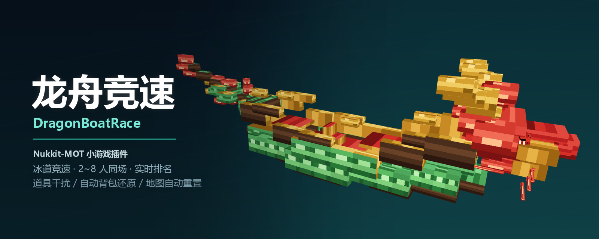

<div align="center">
    
</div>

# <div align="center"><font size=12 color='BlueViolet'>龙</font><font size=6 color="DeepSkyBlue">舟</font><font size=12 color='Red'>竞</font><font size=12 color='Yellow'>速</font>&nbsp;&nbsp;&nbsp;<font size=8 color='Green'>DragonBoatRace</font></div>

**简介:**
玩家骑上龙舟，在冰道或水面上沿着赛道一路冲向终点。沿途的奖励方块会给出加速、磁铁、导弹等干扰道具，谁先冲过终点线，谁就是本轮冠军。第一名冲线后进入统一结算倒计时，结算后自动开下一局，地图也会自动还原。

游戏特色：
1. 房间制竞速，2~8 人同场，自动分配起跑排位，支持中途加入与旁观；
2. 自研龙舟实体，冰道/水面两套物理：加速、漂移、侧滑、碰撞减速，漂移成功还能接一段额外加速；
3. 加速 / 磁铁 / 导弹三类赛道道具，奖励方块拾取后定时刷新，互相干扰；
4. 计分板实时显示名次、进度、与前一名的距离，冲线后按名次执行奖励指令；
5. 进房间自动备份玩家背包（主背包 / 盔甲 / 副手 / 末影箱 / 经验），退房或服务器重启后原样还原。

------

游戏流程：

1. **等待大厅** —— 玩家 `/dbg` 进入房间选择界面，人数达到 `minPlayerSize` 后开始倒计时；
2. **起跑排位** —— 所有参赛玩家被生成龙舟、按起点线居中排开，倒计时期间锁定操作；
3. **竞速** —— 起跑推力发出，龙舟沿赛道前进，途中的奖励方块提供道具；
4. **冲线** —— 第一名过线后开始 `first-finish-countdown` 秒收尾倒计时，期间其余玩家继续冲线；
5. **结算** —— 按名次执行 `ranking-rewards` / `dnf-rewards`，随后自动进入下一局或关闭房间。

------

**使用介绍:**

**下载：** 前往本仓库的 [Releases](../../releases) 页面，下载最新版本的两个 jar。

**一、插件启动**

本插件由两个插件组成，必须**同时安装**：

| jar | 插件名 | 安装位置 | 作用 |
| --- | --- | --- | --- |
| `DragonBoatRace_v1.1.0-SNAPSHOT.jar` | DragonBoat | `plugins/DragonBoat/` | 龙舟 / 导弹 / 奖励箱实体、自定义道具、材质 |
| `DragonBoatGame_v1.0.0.jar` | DragonBoatGame | `plugins/DragonBoatGame/` | 房间系统、DLC、竞速规则、计分板、数据统计 |

1. 把两个 jar 分别放进对应目录（`DragonBoatGame` 通过 `softdepend` 依赖 `DragonBoat`，顺序无需手动控制）；
2. 在 `nukkit-mot.yml` 中确认 **`enable-experiment-mode: true`**（自定义实体与自定义物品依赖实验模式，关掉会出现空气龙舟）；
3. 启动服务器，控制台出现 `DragonBoatRace 已加载` 与 `插件加载完成` 即安装成功；
4. 进游戏执行 `/dbga set 房间名` 开始搭建你的第一条赛道（详见下文「如何配置」）。

> 玩家首次进服需要**接受资源包**（`DragonBoat` 自带 `assets/resource_pack`），否则龙舟会显示成普通船 / 白块。

**二、指令介绍**

玩家指令（默认 `/dbg`）：

| 指令 | 介绍 |
| --- | --- |
| `/dbg` | 打开房间选择界面（GUI） |
| `/dbg join [房间名]` | 加入指定房间 |
| `/dbg rjoin [地图名]` | 随机匹配一个等待中的房间 |
| `/dbg quit` | 离开当前房间 |
| `/dbgs [内容]` | 向房间内全体玩家喊话 |

管理指令（默认 `/dbga`，需要 OP）：

| 指令 | 介绍 |
| --- | --- |
| `/dbga` | 进入房间模板创建向导 |
| `/dbga set [名称]` | 创建一个自定义房间模板 |
| `/dbga back` | 回到上一步 |
| `/dbga end` | 停止模板预设并生成房间文件 |
| `/dbga cancel` | 终止本次房间创建 |
| `/dbga reset` | 重置房间配置文件 |
| `/dbga tsl` | 重新读取模板的队伍数据 |
| `/dbga see` | 查看所有已加载的房间 |
| `/dbga close [名称]` | 关闭指定房间 |
| `/dbga si [名称]` | 将手持物品保存为配置物品 |
| `/dbga float add/remove [房间] [名称] [文本]` | 在脚下创建 / 删除浮空字 |
| `/dbga top add/remove [名称] [类型] [房间]` | 创建 / 删除排行榜 |
| `/dbga robot [房间名] [数量]` | 向房间内加入测试机器人 |
| `/dbga exp [玩家] [数量] [由来]` | 给玩家增加小游戏经验 |
| `/dbga status` | 查看线程与房间运行状态 |
| `/dbga reload` | 重新读取全部配置 |

调试指令（`DragonBoat`，需要 OP）：

| 指令 | 介绍 |
| --- | --- |
| `/dragonboat spawn` | 在准星指向的水面 / 冰面上生成一条龙舟并骑乘 |
| `/dragonboat missile` | 锁定前方 15 格内的玩家并发射导弹 |
| `/dragonboat rewardbox` | 在准星指向的水面 / 冰面生成一个奖励方块 |

> 指令名可在 `config.yml` 的 `command-player` / `command-admin` / `command-msg` 中修改。

**三、道具**

| 道具 | 效果 | 时长 |
| --- | --- | --- |
| 龙舟加速 `dragon_boost` | 速度提升 100% | 8 秒（160 tick） |
| 龙舟磁铁 `dragon_magnet` | 锁定前方目标：自己高速追近，目标强制减速 | 5 秒（100 tick） |
| 龙舟导弹 `dragon_missile` | 锁定前方玩家，命中后冻结对手 | 3 秒（60 tick） |
| 重置位置 `resetBoat` | 把龙舟放回最近的冰道中心（双击确认，防误触） | — |

**四、配置文件**

| 文件 | 介绍 |
| --- | --- |
| `plugins/DragonBoatGame/config.yml` | 主配置：标题、指令名、经验、加入菜单、是否保存背包 |
| `plugins/DragonBoatGame/rooms/<房间名>/room.yml` | 单个房间：地图、人数、时间、地图还原、以及 `dragon-boat-game` 竞速段 |
| `plugins/DragonBoatGame/team.yml` | 队伍、皮肤、初始装备、出生点 |
| `plugins/DragonBoatGame/items.yml` | 随机箱子物品池（格式见文件头注释） |
| `plugins/DragonBoatGame/shop.yml` | 商店菜单与价格 |
| `plugins/DragonBoatGame/event.yml` | 按秒触发的定时事件（药水 / 指令 / 自定义） |
| `plugins/DragonBoatGame/roomEventList.yml` | `custom` 事件引用的事件列表 |
| `plugins/DragonBoatGame/lang/language.ini` | 全部界面文本 |
| `plugins/DragonBoatGame/player-inventory-backup.json` | 玩家进房间前的背包存档（自动生成，**不要删**） |
| `plugins/DragonBoatGame/player.json` / `top.json` / `tag.json` | 玩家数据、排行榜、tag 数据 |

竞速段（`room.yml` 的 `dragon-boat-game`）常用字段：

| 字段 | 介绍 |
| --- | --- |
| `start-line.from` / `to` | 起点线两端坐标，格式 `x:y:z:世界文件夹名` |
| `finish-line.from` / `to` | 终点线两端坐标，同上 |
| `first-finish-countdown` | 首名冲线后，其余玩家的完赛倒计时（秒） |
| `ranking-board-size` | 计分板显示的排名数量 |
| `start-push-strength` | 起跑瞬间统一前推的力度 |
| `item-spawns` | 赛道道具刷新点列表（`position` 坐标；被拾取后固定 5 秒重生） |
| `ranking-rewards` / `dnf-rewards` | 名次奖励 / 未完成奖励，支持 `@p`、`[player]`、`[rank]`、`[time]` 占位符 |
| `boat-variant` | 龙舟材质变体 |
| `finish-lock-speed` | 冲线后的减速系数 |

> `room.yml` 里还有若干预留字段（如道具时长），当前版本由实体内部常量控制，改了不会生效，后续版本再开放。

------

**五、如何配置**

1. 准备一张赛道地图：冰道或水面 + 起点线 / 终点线，把地图放进服务端 `worlds/`（竞速 DLC 会强制 `resetWorld: true`，每局结束自动从备份还原地图）；
2. 在主世界执行 `/dbga set 房间名`，按聊天栏提示依次在游戏内选择模板需要的点位（不要点错，出错请用 `/dbga back` 或 `/dbga cancel` 重来）；
3. 完成后执行 `/dbga end`，插件会在 `plugins/DragonBoatGame/rooms/房间名/` 下生成 `room.yml`；
4. 打开 `room.yml`，确认 `world`、`waitPosition`、`teamSpawn`，并填好 `dragon-boat-game.start-line` / `finish-line`（`x:y:z:世界名`）与 `item-spawns`；
5. 需要改队伍、初始装备、箱子物品时，分别编辑 `team.yml` / `items.yml`，改完执行 `/dbga tsl`（队伍数据）或 `/dbga reload`；
6. `/dbga see` 确认房间已加载，玩家 `/dbg` 即可进入等待大厅开一局。

------

**六、注意事项**

- **背包存档**：玩家进入房间时，插件会把主背包、盔甲、副手、末影箱、经验和选中格写进 `player-inventory-backup.json`，退房或服务器重启后自动还原。该文件是玩家物品的唯一凭据，**不要手动清空**；
- **不要用 `/reload` 重载插件**：`DragonBoatGame` 的房间帧逻辑由主线程调度器驱动，`/reload` 会留下悬挂任务，请用 `stop` 重启；
- **实验模式必须开启**，否则自定义实体（龙舟 / 导弹 / 奖励箱）无法生成；
- **可选前置**：`ScoreboardPlugin`（计分板）与 `Tips`（屏幕文本）为 `softdepend`，缺失时插件会自动降级，不影响竞速流程；
- 竞速房间默认关闭 PVP、死亡掉落、随机箱子与商店（由竞速 DLC 强制覆盖），如需其它玩法请自行扩展 DLC。

------

**七、如何构建**

两个插件是独立的 Maven 项目（非父子 reactor），`DragonBoatGame` 通过 `systemPath` 依赖 `DragonBoatRace` 的构建产物，**必须先构建前者**：

```bash
# 1. 构建核心模型
cd DragonBoatRace && mvn clean package

# 2. 构建游戏框架
cd ..\DragonBoatGame && mvn clean package
```

- 环境：**JDK 17** + Maven 3.9
- `DragonBoatRace` 产物：`DragonBoatRace/target/DragonBoatRace_v1.1.0-SNAPSHOT.jar`
- `DragonBoatGame` 产物：`DragonBoatGame/target/DragonBoatGame_v1.0.0.jar`
- `DragonBoatGame/lib/` 下的 ScoreboardAPI、RsNPC、Tips 等为定制版 jar，请勿替换为仓库坐标
- `plugin.yml` 的版本号由 `maven-replacer-plugin` 自动改写，不要手动编辑
- 项目没有单元测试，`mvn test` 无意义

------

**八、常见问题**

| 问题 | 排查方向 |
| --- | --- |
| 龙舟显示成普通船 / 白块 | 客户端没接受资源包，或服务端未开启 `enable-experiment-mode` |
| 进房间背包没了 | 检查 `config.yml` 的 `save-playerInventory: true`，以及 `player-inventory-backup.json` 是否存在；本版本之前丢失的物品没有快照，无法找回 |
| `/dbg` 没反应 | 确认 `DragonBoatGame` 已加载、`join-menu` 里配置了地图与房间名 |
| 高速行驶被「回拉」 | 已在本版本修复（房间逻辑回到主线程 + 输入源修正）；如仍出现请查看服务端 TPS 与其它高频插件 |
| 房间不自动开下一局 | 检查 `room.yml` 的 `AutomaticNextRound` 与 `waitTime` |
| 结算没有奖励 | `ranking-rewards` 里要写完整指令；`@p` 与 `[player]` 会被直接替换成玩家名（不是原版目标选择器），`[rank]`、`[time]` 同理 |

------

**九、更新日志**

**v2（2026-11-21）修复版**

- 修复服务器重启后玩家背包无法还原（改为磁盘持久化存档）；
- 补齐盔甲与副手栏位的备份 / 还原，经验与快捷栏选中格一并保存；
- 修复 `clear()` 被重复调用导致刚还原的背包又被清空的问题；
- 修复房间帧逻辑跑在后台线程、与主 tick 抢写实体导致的高速回拉、抖动；
- 区块预加载改为按"跨区块"触发，不再每秒强制加载数十个区块；
- 龙舟输入以 `PlayerInputPacket` 为准，不再被 `PlayerAuthInputPacket` 覆盖成 0；
- 尾迹粒子 / 水声降频，起终点烟雾粒子改为每 4 秒一轮；
- 重置按钮优先放入空位，不再顶掉玩家捡到的道具。

------

**十、致谢**

- [Nukkit-MOT](https://github.com/Nukkit-MOT/Nukkit-MOT) —— 服务端核心
- 作者：Sobadfish

<!--
---------- 游戏内效果（截图准备好后取消注释即可） ----------

**游戏内效果:**

|  |  |
| -------------------- | -------------------- |
|  |  |
-->

